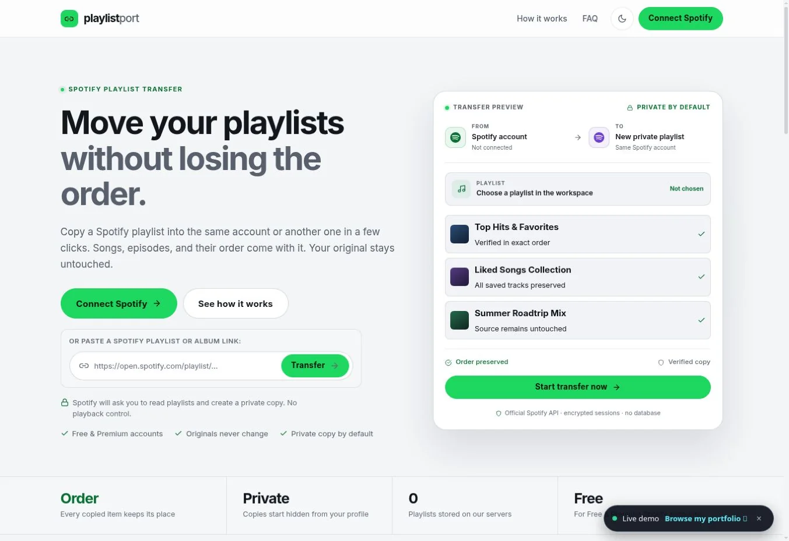

# Playlist Port

A React and Express app for copying Spotify playlists and albums into a new playlist in the same account or a second account.

**[Live demo](https://playlist-port-nine.vercel.app/)** · [Portfolio case study](https://teddy-qyuon-portfolio.vercel.app/projects/playlist-port-spotify-mover)



## Scope and contribution

An AI-assisted personal MVP by Wai Yan Hpone Lat. It combines Spotify OAuth, paginated source reads, ordered batch writes and a transfer queue with completion, partial-failure and skipped-item feedback.

- Copy supported playlists or albums while preserving item order.
- Search and filter the queue, follow progress and cancel a transfer.
- Empty sources are skipped; unsupported links receive guidance.
- Spotify-to-Spotify transfers are supported. Other music services are planned.

Transfers require Spotify accounts approved for the developer app. Copies use `public: false`, which hides them from the public profile; use Spotify’s **Make private** control to restrict link access. No audio files are copied.

## Stack

React, Vite, JavaScript, CSS, Node.js, Express and the Spotify Web API. OAuth credentials and access tokens stay on the server.

## Run locally

Verified locally with Node.js 22.

```bash
git clone https://github.com/TeddyQyuon/playlist-port.git
cd playlist-port
npm ci
```

Copy `server/.env.example` to `server/.env`. Configure your Spotify client ID, client secret and a random session secret locally. Register `http://127.0.0.1:3001/api/auth/callback` as the Spotify redirect URI, and add the source and destination accounts to the developer-app allowlist.

```bash
npm run dev
```

Open `http://127.0.0.1:5173`. The API runs on port 3001. Use `127.0.0.1` consistently for local OAuth callbacks. See [Spotify’s quota-mode documentation](https://developer.spotify.com/documentation/web-api/concepts/quota-modes) for current access requirements.

## Checks and production build

```bash
npm test
npm run build
```

`npm start` serves the built client and API. Set `CLIENT_ORIGIN` to the serving origin in your local server environment. Tests use mocked Spotify responses; a passing test run does not establish that an unapproved account can transfer playlists.

## Developer documentation

- [Setup and deployment](SETUP_AND_DEPLOY.md)
- [Security notes](SECURITY.md)

The repository also retains design-token and accessibility tooling used by its npm scripts.
